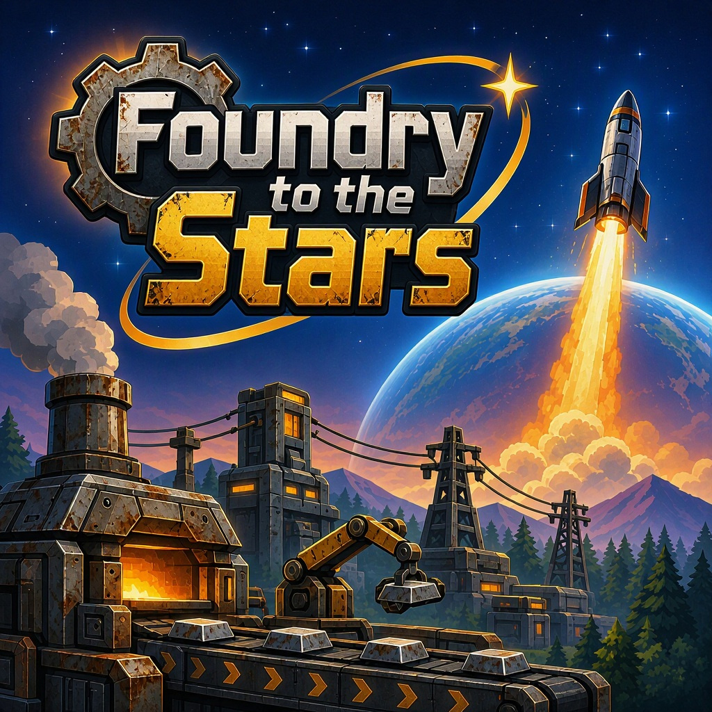

 [](README.ru.md)

# Foundry to the Stars

A 2D automation game: build a factory on an alien planet and assemble a rocket to return home.

Status: in development.
Platform: Windows.
Engine: Unity 6.6, 2D URP, C# 2.160.4.

## Running the project

1. Install Unity Hub and Unity 6.6 with Windows Build Support.
2. Clone the repository:

```bash
git clone https://github.com/RegidGhost/Foundry-to-the-Stars.git
```

3. Open the project folder via Unity Hub.
4. Open `Assets/Scenes/MainScene.unity`.
5. Press Play.

## Building

In Unity: `File -> Build Settings -> Windows -> Build`.

## Structure

```text
Assets/
├── Scripts/   game code
├── Data/      ScriptableObject assets
├── Prefabs/   prefabs
├── Art/       sprites and tiles
├── Audio/     music and SFX
└── Scenes/    scenes
```

## License

MIT. See `LICENSE`.


